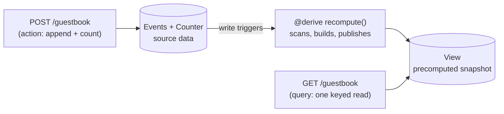

# Derived views (`@derive`)

A `@derive` keeps a fast, precomputed **View** of your data in sync automatically. You write a method that reads your source data and publishes a summary; toiljs re-runs it whenever the source data changes, so your pages can read the summary with one cheap lookup instead of doing the work on every request.

## The problem it solves

Some reads are expensive. "Show the 10 newest comments" means scanning an [events](../database/events.md) log. "Show the leaderboard" means totalling up scores. A **scan** (walking many rows to build a result) can fan out across an unbounded amount of data, and that is too slow and too unpredictable to do while a user waits.

So toiljs **bars scans on the request path**. A [route](../backend/rest.md) handler runs under a restricted mode:

- A `@get` runs as a **query** (reads only, no scans).
- A `@post` / `@put` / `@patch` / `@del` runs as an **action** (keyed reads and writes, still no scans).

If you cannot scan in a route, how do you show "the latest 10"? You precompute it. A `@derive` does the scan **off** the request path, folds the result into a [View](../database/views.md) (a read-optimized snapshot stored by key), and your route reads that View with a single keyed lookup, which is not a scan and so is allowed.



## A worked example: a guestbook

Here is the whole pattern in one database class: an [events](../database/events.md) log of signatures, a [counter](../database/counters.md) of how many there are, and a [View](../database/views.md) that holds the ready-to-serve page.

```ts
@data
class GuestKey {
    room: string = 'main';
    constructor(room: string = 'main') { this.room = room; }
}

@database
class GuestbookDb {
    @collection static entries: Events<GuestKey, GuestEntry>;  // a source: the log
    @collection static totals: Counter<GuestKey>;              // a source: the count
    @collection static book: View<GuestKey, GuestbookView>;    // the view we publish

    // Recompute the view from the sources. It MAY scan and publish; a route may not.
    @derive
    recompute(): void {
        const key = new GuestKey('main');
        const view = new GuestbookView();
        view.total = GuestbookDb.totals.get(key);          // a keyed read
        view.entries = GuestbookDb.entries.latest(key, 10); // a scan: allowed here
        GuestbookDb.book.publish(key, view);               // publish the snapshot
    }
}
```

The route then writes to the sources and reads the view:

```ts
@rest('guestbook')
class Guestbook {
    @get('/')
    list(): GuestbookView {
        const key = new GuestKey('main');
        const view = GuestbookDb.book.get(key);   // one keyed read, not a scan
        return view == null ? new GuestbookView() : view; // empty until first publish
    }

    @post('/')
    sign(input: NewMessage): GuestbookView {
        const key = new GuestKey('main');
        GuestbookDb.entries.append(key, new GuestEntry(input.author, input.message, 0));
        GuestbookDb.totals.add(key, 1);
        // The @derive republishes `book` right after this action returns, so GET
        // serves the new entry. The action just acks with the new total (a counter
        // read is allowed here; scanning the entries list is not).
        const view = new GuestbookView();
        view.total = GuestbookDb.totals.get(key);
        return view;
    }
}
```

Sign the guestbook twice and the total climbs across requests, because the data lives in the database (and its view), not in module memory.

## What a `@derive` may do

A `@derive` runs under a special **derive** mode that is more powerful than a route:

| Ability                                      | Query (`@get`) | Action (`@post` ...) | Derive       |
| -------------------------------------------- | :------------: | :------------------: | :----------: |
| Keyed reads (`.get`, counter total)          | yes            | yes                  | yes          |
| Document writes (`create`, `patch`, `delete`) | no | yes | no |
| Event append / counter add | no | yes | yes |
| Membership / sorted-index add or remove | no | yes | no |
| **Scans** (`events.latest`, membership list) | **no**         | **no**               | **yes**      |
| `view.publish` / `view.append`               | no             | no                   | yes          |

A derive may publish or append to Views, append events and add to counters.
It cannot create, patch or delete Documents, or call `Membership.add/remove` and `SortedIndex.add/remove`; those writes
belong in an Action or Job. The compiler and both hosts enforce this restriction.

So a derive is exactly the place to do the reads and scans a route cannot, and to publish the result.

## Declaring a derive

A `@derive` is a method on your [`@database`](../database/setup.md) class, next to the collections it reads and the View it writes.

```ts
@database
class MyDb {
    @collection static events: Events<Key, Fact>;  // a source
    @collection static home: View<Key, HomePage>;  // the materialized view

    @derive
    rebuild(): void {
        // read sources, build the value, publish it
    }
}
```

Rules:

- A `@derive` method takes **no arguments and returns `void`**.
- A database may declare **multiple** `@derive` methods; each runs independently.
- The View value and its key are ordinary [`@data`](../backend/data.md) types, so they round-trip through the codec like any other stored value.

## When a derive runs

You never call a derive yourself. The runtime runs it for you at two moments:

1. **After a write to a source.** When a request, job, or daemon writes one of the database's source collections (an `events.append`, a `counter.add`, a document `create` or `patch`), that database's derives run **right after the response is produced**, so the view reflects the new data on the next read. Cold artifacts include the shared databases' materializers and run them after startup and scheduled writes without needing an HTTP request. Rebuild cold artifacts with the updated compiler to get this behavior. Older cold artifacts without materializers retain their deferred hot-request fallback. Many writes to one database in a single request are **coalesced** into one recompute (it does not run once per write).

2. **On box load.** When a server box starts, hot-reloads, or notices the underlying data changed out of band, the views are rebuilt from their sources **before the first read is served**. This is also where a value type's [`@migrate`](../backend/data.md) runs against old stored events, as the derive re-reads and republishes them.

A derive's own `view.publish` never re-triggers it, so there is no infinite loop.

A failed cold fold retains its pending work and leaves its checkpoint unchanged.
The daemon scheduler retries pending folds on its next iteration, including idle
iterations when no scheduled task is due, while it holds the leadership lease.
Dev retries once per second. No HTTP request is needed to trigger a retry.

The same code runs under `toiljs dev` (the in-process emulator) and on the production edge, with no flags or wiring to change.

## Folding a growing log incrementally

The guestbook above uses `events.latest` and **recomputes** the view from scratch on every change. That is simple, correct, and the right default for a **bounded** read: the latest N, a counter total, a small set.

Some views instead fold an **unbounded** log: a running total over every event ever, an activity rollup, an audit summary. Rescanning the whole log on every change gets slower as it grows. For those, read the source with [`events.since`](../database/events.md) instead of `latest`. `since` hands you only the events you have **not folded yet**, so the derive folds forward incrementally.

```ts
@derive
rollup(): void {
    const key = new StatsKey('all');
    const view = StatsDb.summary.get(key) ?? new Summary();   // the running view so far
    let batch = StatsDb.events.since(key, 500);
    while (batch.length > 0) {                                 // drain the new events in bounded batches
        for (let i = 0; i < batch.length; i++) view.apply(batch[i]);
        batch = StatsDb.events.since(key, 500);
    }
    StatsDb.summary.publish(key, view);
}
```

The host owns the cursor, you never manage it: it seeds `since` from a durable checkpoint, advances it as it hands you events, and saves it **only after** your `publish` lands (so a crash re-folds the batch instead of skipping it). On the next trigger the derive resumes exactly where it left off.

**One rule: the fold must be idempotent per event.** A rare crash-recovery case (an event that "heals" at an older position after the derive already passed it) makes the host re-read the whole log that one run, so applying an event twice must not change the result. Use set-style updates keyed by the event's id, not blind `count += 1` accumulation. If your fold cannot be idempotent, stay on the simple `latest` recompute path.

## Guarantees and limitations

**Guarantees**

- **It converges to a correct snapshot.** Publishes are last-writer-wins (the host versions each publish so a later one always supersedes an earlier one), and a derive recomputes from the source of truth, so the view always ends up matching its sources.
- **Reads stay cheap.** A route serves the view with a single keyed lookup, never a scan.

**Limitations (read these)**

- **By default it recomputes from scratch each time.** A derive re-reads its sources and republishes on every trigger. That is the simple path and a great fit for a **bounded** read: the latest N, a counter total, a small set. To fold an **unbounded, ever-growing** log efficiently, read it with [`events.since`](../database/events.md) instead of `latest` (see [Folding a growing log incrementally](#folding-a-growing-log-incrementally) above); it folds only the new events since a checkpoint.
- **It is eventually consistent, by a moment.** The view is republished right after the writing request finishes, so there is a tiny window where a reader could see the pre-write view. For most pages (a feed, a leaderboard) that is invisible and fine.
- **`view.publish` is derive-only.** Routes cannot publish; they can only read the view. That is the whole point: the expensive build happens off the request path.

## When not to use a derive

- **When the read is already cheap.** If a route can answer with a plain keyed `.get`, you do not need a view at all.
- **When the task is only a scheduled side effect.** Use a [daemon Job](./daemons.md). A timed materialized projection can call `Db.runDerive` from that Job (see below).
- **When the source is an unbounded full-history fold.** See the limitation above; keep derives to bounded reads.

## Related

- [Views](../database/views.md): the `View<K, V>` family a derive publishes into, and how to read it.
- [Events](../database/events.md): the append-only log a derive commonly folds into a view.
- [Counters](../database/counters.md): running totals a derive can read.
- [Background overview](./README.md): `@derive` versus `@daemon`, and which to reach for.
- [Data types (`@data`)](../backend/data.md): the value and key types a view stores.


## Stable incremental checkpoints

Durable `events.since` checkpoints use the database and method name, independently
of the artifact-local numeric dispatch index. Inserting or reordering a derive
therefore preserves each existing method's cursor. Renaming a database or method
creates a new cursor. Upgrading from ordinal-only checkpoints starts named cursors
from the beginning, rather than attach another method's cursor; folds must remain
idempotent when replaying existing events.


## Reading invalidated keys

`Db.changes()` is available inside a derive. It returns `fullRescan: bool` and
`keys: DbChange[]`; each entry contains `database`, `collection` (without the
database prefix), and the original encoded `key`. Decode the key with that
collection's key type, then read the current row. An absent row means the
materialized entry must be removed. Keep enough index information to remove an
entry whose old sort key or group changed.

```ts
const changes = Db.changes();
if (changes.fullRescan) {
    // Rebuild from your source index or resumable event log.
} else {
    for (let i = 0; i < changes.keys.length; i++) {
        const change = changes.keys[i];
        if (change.collection != 'listings') continue;
        const key = ListingKey.decode(change.key);
        const current = Market.listings.get(key);
        // Idempotently replace or remove the indexed listing.
    }
}
```

Keys are deduplicated invalidation hints from collections that committed writes;
they can include reads, retries, and no-op attempts in those collections. They
are not an ordered event stream and contain neither old values nor write counts.
Only the derive's database is included. Membership and event keys identify the
set or partition, rather than an individual member or event.

Always implement the full-rescan path. Startup, failed-run retries, hints arriving
from another execution surface, an unknown mutation, or overflow requests a full
rescan with an empty key list. The context holds at most 256 keys and 64 KiB of
framed metadata. It is request context rather than durable history; keep
`events.since` for durable event processing. Reading context consumes host gas,
without consuming a database operation or replacing the last result stash.

## Running a derive on a timer

A scheduled Job can invoke a materializer directly with
`Db.runDerive(databaseName, methodName, body)`. This enters Derive context for
the callback, supplies `Db.changes().fullRescan`, and uses the same named
`events.since` checkpoint as automatic runs. The Job's existing budget and
consumed counters remain in effect.

```ts
function refreshBrowse(): void { new Market().refreshBrowse(); }

@daemon
class Timers {
    @scheduled('1h')
    @job
    refresh(): void {
        Db.runDerive('Market', 'refreshBrowse', refreshBrowse);
    }
}
```

The database and method strings must exactly match the `@derive` declaration.
Keep the database in a shared source file included in both artifacts. Checkpoints
commit after the callback returns successfully. A trap preserves completed
writes and leaves its checkpoint unadvanced, so callbacks must be idempotent.
Calls outside a Job, nested calls, and empty or oversized identities trap.
This API lets a scheduled Job remove expired events from a projection without
appending a synthetic source change. It runs one bounded invocation per call;
keep large rebuilds resumable within the Job budget.

## Requesting another invocation

Call `Db.continueDerive()` when a bounded fold has more work. The request is
persisted before the call returns. The resident cold scheduler polls queued work
while idle, so no unrelated write or HTTP request is required. Repeated calls
within one invocation coalesce into one DB operation/write. The budget meter
includes that operation and its control-row bytes.

```ts
@derive
fold(): void {
    const rows = Market.changes.since(new FeedKey(), 64);
    for (let i = 0; i < rows.length; i++) applyIdempotently(rows[i]);
    if (rows.length == 64) Db.continueDerive();
}
```

A continuation runs with fresh gas/DB limits and `Db.changes().fullRescan`; its
named `events.since` cursors still resume after successfully published batches.
A crash before a cursor commit can repeat a batch, so processing must remain
idempotent. Acknowledgements match a generation: an older run cannot clear a
newer continuation. The queue is bounded to 1024 identities and 256 KiB per
tenant; a full queue fails explicitly. Removed/renamed methods do not inherit
another method's pending work.

Include a resident `@daemon` (an empty class is sufficient) and put materializer
databases in shared source files compiled into both artifacts. The framework
build rejects missing cold materializers when a hot artifact imports this API.
Run the cold scheduler and use the same persistent ToilDB control storage for
the hot and cold workers. The native in-memory adapter is ephemeral; persistent ToilDB provides
the durable queue. Dev persists it with the configured DB snapshot. Updated
native host imports are required. Calls outside Derive, or with no deployed
`@derive` identity, fail closed. `Db.runDerive` can also request a continuation
when its names match a deployed materializer.
