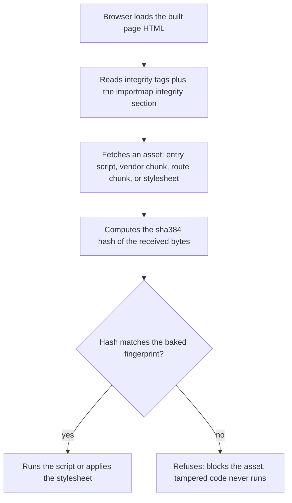

# Security

toiljs enables an enforced Content Security Policy (CSP), Cross-Origin-Opener-Policy (COOP), and Trusted Types by default in its development and self-host servers. Production builds include script integrity metadata and security headers for deployment. This page explains those defaults, how to allow additional resources, and what an external host must serve.

## The model

Toil is built for **defense in depth**: many independent layers, so that one weak spot is not one breach. The goal is the top of our internal security bar, the Resilience and Scale Grade (see [../../RSG.md](../../RSG.md)), where each of these holds at the same time:

- All traffic is encrypted in transit with modern TLS (Transport Layer Security, the encryption every `https://` connection uses).
- The login design never lets the server see a password it could reuse.
- Secrets never live in your code.
- Built scripts and styles carry integrity metadata; module-graph verification also applies in browsers supporting import-map integrity.
- There is no implicit trust between the parts of the system (zero trust): each request is checked on its own merits.

The rest of this page walks through each layer and points to where it is documented in full.

## Default browser security

No configuration is needed for the framework's development or self-host servers. The defaults are:

| Protection | Default | Purpose |
| --- | --- | --- |
| Content Security Policy | Enforced `Content-Security-Policy` header | Restricts script execution and resource loading. This is not a report-only policy. |
| Opener isolation | `Cross-Origin-Opener-Policy: same-origin` | Isolates the document from cross-origin openers and popups. |
| Trusted Types | `require-trusted-types-for 'script'` in the CSP | Requires trusted values at DOM injection sinks in supporting browsers. |
| Policy creation | `trusted-types toil-script dompurify` | Allows the framework's script and HTML policies. No default policy is installed. |

HSTS is not emitted by toiljs. Configure it at your HTTPS deployment if needed.

### The enforced CSP

The production policy uses these directives. The script hashes are generated from the build; do not copy placeholder hashes into a deployment.

| Directive | Default |
| --- | --- |
| `default-src` | `'self'` |
| `base-uri` | `'none'` |
| `object-src` | `'none'` |
| `frame-ancestors` | `'self'` |
| `script-src` | Generated script hashes, `'strict-dynamic'`, and `'wasm-unsafe-eval'` |
| `script-src-attr` | `'none'` |
| `style-src` | `'self' 'unsafe-inline'` |
| `img-src` | `'self' data: blob:` |
| `font-src` | `'self' data:` |
| `connect-src` | `'self'` |
| `worker-src` | `'self' blob:` |
| `require-trusted-types-for` | `'script'` |
| `trusted-types` | `toil-script dompurify` |

The compiler authorizes inline template scripts by their content hashes and external entry scripts by their integrity hashes. It also includes the integrity hashes for the bundled module graph. Prerendered pages, SSG pages, and SSR templates inherit the protected shell. Request values inserted into SSR slots do not receive new script hashes.

Inline event handlers and JavaScript `eval` are blocked. `'wasm-unsafe-eval'` permits WebAssembly compilation, which client password hashing needs, without allowing JavaScript `eval`. Inline CSS remains allowed for React style props and framework styles.

Backend responses without an explicit CSP receive the same resource and DOM protections with `script-src 'none'`. Consequently, a standalone `Response.html(...)` does not authorize executable scripts. A custom HTML handler that needs scripts must provide an appropriate CSP explicitly.

### Development and SSR

`toiljs dev` uses fresh request nonces for scripts instead of production hashes. WebSocket connections (`ws:` and `wss:`) are permitted for HMR. This applies both to the client-only Vite server and to the Vite proxy used by backend projects.

Development SSR rotates the nonce in the trusted template before inserting request values. Production SSR takes its policy from the built template. Both paths preserve script loading and hydration without enabling unrestricted inline scripts or JavaScript `eval`.

### Loading scripts

Use [`Toil.Script`](../frontend/scripts.md) for application-controlled scripts loaded from React:

```tsx
<Toil.Script src="https://widgets.example.com/widget.js" />

<Toil.Script id="configure-widget">
    {'window.widgetOptions = { compact: true };'}
</Toil.Script>
```

External script URLs must use HTTP(S). Executable inline snippets load through temporary blob URLs created by the framework; those URLs are revoked after loading. `onLoad` and `onReady` run after an executable script has loaded and executed. Inert data blocks such as `type="application/json"` remain inline. Inline module snippets must use absolute import URLs because relative imports cannot resolve against a blob URL.

Only pass application-controlled code and URLs to this component. A third-party script can require additional connection, image, stylesheet, or frame origins; authorizing the script itself does not allow every resource it might request.

### Trusted Types and HTML

In supporting browsers, raw string assignments to protected DOM sinks such as `innerHTML` are rejected. `Toil.Script` handles its own trusted script values. `Toil.RawHtml` sanitizes HTML in the browser through a private DOMPurify instance and supplies a trusted HTML value where supported:

```tsx
<Toil.RawHtml id="article" html={articleHtml} />
```

**Sanitize HTML on the server before putting it into an SSR raw slot.** Browser sanitization cannot protect the initial HTML response, which is parsed before hydration. The same server responsibility applies to `SlotValues.setRaw` and `HtmlBuilder.raw`.

`Toil.sanitizeHtml(html)` is also available for browser code that needs sanitized HTML for React's `dangerouslySetInnerHTML`. It returns `string | TrustedHTML` and throws without a browser DOM. If a component calls it while rendering, place that component inside `Toil.Island` so it runs only after hydration. Browsers without Trusted Types still receive DOMPurify sanitization and the other supported CSP protections.

### Allowing additional resources

Add resource origins in `client.cspSources` rather than replacing the generated CSP:

```ts
// toil.config.ts
import { defineConfig } from 'toiljs/compiler';

export default defineConfig({
    client: {
        cspSources: {
            'connect-src': ['https://api.example.com', 'wss://events.example.com'],
            'img-src': ['https://images.example.com'],
            'style-src': ['https://styles.example.com'],
            'font-src': ['https://fonts.example.com'],
            'frame-src': ['https://widgets.example.com'],
        },
    },
});
```

Values are appended to the directive's defaults. If an allowed directive is absent from the default policy, toiljs creates it starting with `'self'`. Changes apply to development and to the production header and meta policy after rebuilding.

Supported keys are `connect-src`, `img-src`, `media-src`, `font-src`, `style-src`, `frame-src`, `child-src`, `worker-src`, `manifest-src`, `trusted-types`, `form-action`, `frame-ancestors`, `script-src`, `script-src-elem`, and `require-trusted-types-for`. For `trusted-types`, supply policy names rather than origins, and only add names for reviewed policies your application needs.

Each array entry must be a nonempty source token without whitespace, semicolons, commas, or angle brackets. Unsupported keys and invalid values are rejected. `script-src-attr`, `default-src`, `base-uri`, and `object-src` remain framework-owned. See the [configuration reference](./config.md#clientcspsources).

Explicit `script-src` and `script-src-elem` arrays **replace** their generated
directives instead of extending them. An empty script array means `'none'`.
An empty `require-trusted-types-for` array removes DOM sink enforcement. Omitting
these options preserves the strict hash/nonce, strict-dynamic, and Trusted Types
defaults. These explicit overrides are for integrations that inject scripts after
the build and cannot use the normal trusted script loader.

For example, a site that chooses Cloudflare's automatically injected Web Analytics
and JavaScript Detections can configure:

```ts
client: {
    cspSources: {
        'script-src': ["'self'", "'unsafe-inline'", "'wasm-unsafe-eval'", 'blob:',
            'https://static.cloudflareinsights.com', 'https://challenges.cloudflare.com'],
        'connect-src': ['https://cloudflareinsights.com', 'https://challenges.cloudflare.com'],
        'frame-src': ['https://challenges.cloudflare.com'],
        'require-trusted-types-for': [],
    },
}
```

This permits arbitrary inline script elements and raw DOM sinks, so it offers
less injection protection than the default policy. Inline event handlers and
JavaScript eval remain blocked. Prefer the default with `Toil.Script` for
integrations you control, or a fresh per-response nonce integration at the origin.
Deploy rebuilt HTML and the updated HTTP policy together: a more permissive
header cannot override an older restrictive HTML meta policy, or vice versa.

### COOP and custom responses

`Cross-Origin-Opener-Policy: same-origin` affects integrations that depend on a cross-origin popup retaining its opener. It does not enable COEP or guarantee `window.crossOriginIsolated` by itself.

A backend handler can explicitly set CSP or COOP with `Response.setHeader`. Framework defaults fill absent headers case-insensitively and preserve explicit application values. For example, a custom handler that deliberately needs opener compatibility can set:

```ts
return Response.html(html)
    .setHeader('Cross-Origin-Opener-Policy', 'same-origin-allow-popups');
```

This changes that handler's response. It does not change the policy of frontend pages served from the build. Keep the CSP header and the built HTML's meta policy consistent; a more permissive header does not remove restrictions from an existing meta policy.

### Deployment headers

`toiljs start` serves CSP and COOP automatically, including when running multiple HTTP workers. Native backend HTTP response envelopes also include defaults. The production build writes `_headers` into the configured client output directory (`build/client/_headers` by default):

```text
/*
  Content-Security-Policy: <the complete policy generated for this build>
  Cross-Origin-Opener-Policy: same-origin
```

Hosts that support this file format can consume it directly. Other static hosts, reverse proxies, and managed edge integrations must apply the generated headers to their document responses, including SSR responses. Merely uploading the HTML does not configure an external host's HTTP headers.

After a successful client build, `toiljs build` prints deployment instructions
from the final `_headers` file, including rules written by project plugins. The
output includes Cloudflare filter expressions, header names, complete values,
and the **Set static** or **Remove** operation for each rule, in file order.
The hostname comes from `client.seo.url` when configured; otherwise the output
asks you to scope the expressions to your deployment hostname. Paths, wildcard
rules, CSP resource origins, and COOP exceptions come from the generated rules.
Rules using placeholders are shown with instructions to configure them at the
origin or in a Worker. No additional logging flag is required. Server-only
builds and builds without generated CSP/COOP policies do not print these steps.

The HTML includes a CSP meta fallback. **COOP and `frame-ancestors` require HTTP headers**; the fallback cannot supply them. Preserve the generated import map, integrity attributes, and CSP metadata. Rebuild after changing scripts or resource permissions, and deploy matching HTML, assets, and headers together. See [Deploying a toiljs app](../getting-started/deploy.md#default-browser-security).

### Checking a deployment

Inspect a real document response from your deployed origin:

```bash
curl -sSI https://app.example.com/
```

Confirm it includes an enforced `Content-Security-Policy` with `require-trusted-types-for 'script'` and `Cross-Origin-Opener-Policy: same-origin`. Check an SSR URL too if your app uses SSR. In browser developer tools, review CSP violations while exercising navigation, scripts, and integrations. A CSP violation usually identifies the resource and directive that need attention.

The framework's regression suite checks headers, native response envelopes, sanitization, and browser behavior. From the framework checkout, run:

```bash
npm run build
npx vitest run test/security.test.ts test/security-native.test.ts test/dom/security.test.tsx
TOILJS_BROWSER_TESTS=1 npx vitest run test/security-browser.test.ts
```

The browser suite requires Chrome. Set `CHROME_BIN` if it is installed outside `/usr/bin/google-chrome`. It checks blocked injections alongside SSR hydration, lazy routes, `Toil.Script`, static serving, production workers, and development HMR.

## The backend is a sandbox

Every site (every tenant) on toil runs inside a **sandbox**: a walled-off compartment that can only touch what the host explicitly hands it, and can never reach the host itself or another tenant. Your server code is compiled to **WebAssembly** (wasm, a portable binary instruction format that runs in a tightly controlled virtual machine), and the edge loads each tenant as its own isolated wasm module.

That isolation is backed by **hard per-host limits**, enforced by the host and not by your code:

- **A committed-memory cap.** Each tenant may commit only a bounded amount of real memory (on the order of tens of MiB). A tenant cannot grow without bound and starve its neighbors.
- **A compute cap.** Each request gets a bounded compute budget, and when a request exceeds it, the host stops it. A tenant cannot spin forever on the request path.
- **Rate limits.** How often one client may call a route is capped (see [Transport and rate limiting](#transport-and-rate-limiting) below).
- **Hostile-wasm containment.** The runtime is hardened to run untrusted, even deliberately malicious, wasm without letting it escape.

The point of all of this: a buggy or malicious tenant can crash or hang only itself. It cannot escape its sandbox, exhaust the host, or read or corrupt another tenant's data.

## Passwords: post-quantum login

Toil ships a complete login system you turn on with one line, and it is built so the server never handles a usable password. See [../auth/README.md](../auth/README.md) for the overview and [../auth/how-it-works.md](../auth/how-it-works.md) for the mechanism.

Here is why that matters. The pattern almost the whole internet uses is "send the password over TLS, then hash it on the server." That is the accepted baseline, but it caps security below the top grade, because for a moment the server holds a live, replayable credential. Anything that reads server memory or a stray log line at the wrong instant walks away with real passwords, and that is one of the most common breach paths in practice.

Toil designs that surface away. The proof that you know your password happens without the password ever crossing the wire in a form anyone can replay, so a fully breached server still yields no usable credentials.

## Subresource Integrity (SRI) on the client bundle

This is the layer that protects the code running in your users' browsers.

### The risk

Your app's JavaScript and CSS are static files served over the network, often through a CDN (Content Delivery Network, the fleet of edge caches that sits between your server and the browser). If any point in that path is compromised (the host, a cache, or the network itself), an attacker can serve **tampered** JavaScript or CSS: a modified bundle that steals sessions, skims form input, or rewrites the page. The browser, on its own, has no way to know the bytes it received are not the bytes you shipped.

### What toil does at build time

**Subresource Integrity (SRI)** is a browser feature that closes this gap. You attach a cryptographic fingerprint of a file to the tag that loads it, and the browser refuses to use the file unless its bytes match that fingerprint.

At build time (verified in [../../src/compiler/sri.ts](../../src/compiler/sri.ts)), toil adds that fingerprint to every **local** asset tag in the built HTML:

- every `<script src=...>`,
- every `<link rel="modulepreload" href=...>`,
- every `<link rel="stylesheet" href=...>`.

To each it adds two attributes: `integrity="sha384-<base64>"` and `crossorigin="anonymous"`.

- **`sha384`** is the hash algorithm: the file's bytes are run through SHA-384 (a member of the SHA-2 family), producing a fixed fingerprint that changes if even one byte changes. The `integrity` value is that fingerprint, base64-encoded, with a `sha384-` prefix.
- **`crossorigin="anonymous"`** is required for the browser to actually verify the fingerprint. It is a no-op when the asset is same-origin, so adding it is always safe.

Tags that are not toil's to hash are left completely untouched: external URLs (anything with a scheme like `https:`, a protocol-relative `//cdn/...`, or a `data:` URI), inline scripts (a `<script>` with no `src`), and any tag that already carries its own `integrity`.

### Why an import map is also emitted

A per-tag `integrity` only protects the **entry** script: the one file named directly in the tag. But a modern app is an ES module graph (ECMAScript modules, the browser's native `import` system). The entry script statically imports other chunks (for example the shared React vendor chunk), and it lazily pulls in each route with a dynamic `import()` as the user navigates. Those follow-on files are fetched by the browser's **module loader**, which does **not** inherit the entry tag's `integrity`. Without more, everything past the entry point would be unverified.

So toil also emits an **import map**: a `<script type="importmap">` tag (a standard browser mechanism for describing module resolution). Its `integrity` section maps every emitted JavaScript chunk to its own `sha384` fingerprint. This is the platform mechanism that extends verification to the module loader's fetches, so the **full** dynamic `import()` graph is covered, not just the entry tag. Browsers that do not yet support the `integrity` key simply ignore it (progressive enhancement: nothing breaks on older browsers, they just get one fewer check).

### Why it stays stable

A fingerprint is only useful if it keeps matching the bytes actually served. Toil guarantees that by **content-hashing** every asset it puts SRI on: the build tool (Vite) names each JavaScript chunk and each CSS file with a hash of its own contents baked into the URL (verified in [../../src/compiler/vite.ts](../../src/compiler/vite.ts)). Because the URL is pinned to the exact bytes, the fingerprint baked into the HTML can never falsely mismatch.

This prevents a real failure mode. Imagine a stylesheet kept a stable URL but its bytes changed on a new deploy. A user still holding an older HTML page (with the old baked fingerprint) would fetch the new bytes, the hashes would disagree, and the browser would **block** the stylesheet, breaking the page for that user. Content-hashing sidesteps this: new bytes get a new URL, so old HTML keeps pointing at the old bytes, and every fingerprint always matches. (Images and fonts keep stable names on purpose: they carry no SRI and are often referenced by fixed path.)

### What the browser does

For each asset that carries an `integrity` value (from a tag or from the import map), the browser hashes the bytes it received and compares them to the expected fingerprint. If they match, it runs the script or applies the stylesheet. If they do not match, it refuses: the asset is blocked and tampered code never runs.



### When it applies

SRI is part of the **production build output**. The dev server hands the browser un-hashed modules straight from Vite, where SRI would be meaningless, so it is not applied there. You get the protection automatically in what you ship, with nothing to configure.

## Secrets

Secrets (API keys, signing keys, and the like) are **never compiled into the wasm**. They are provided per-host at runtime through the secure environment store and read with `Environment.getSecure(key)`, which is kept strictly separate from the plain-variable `Environment.get(key)`: a secret can never leak out through a code path that only reads plain config. Because secrets live outside your code, they are never in your repository or its history. See [../services/environment.md](../services/environment.md) for the full model.

## Transport and rate limiting

All traffic runs over modern **TLS**, so nothing sensitive travels in the clear. The edge speaks **HTTP/3** (built on QUIC, a faster, head-of-line-blocking-free transport) with graceful fallback to HTTP/2 and HTTP/1.1, so newer clients get the modern path and older clients still connect and work.

On top of that, you can cap how often a client may hit any given route. Adding the `@ratelimit` decorator to a route makes the edge reject a client that goes over the limit **before your code runs**, which blunts brute-force and abuse and helps absorb bursts and denial-of-service (DDoS) pressure at the edge rather than inside your handler. Only routes that opt in pay any cost; everything else stays on the untouched fast path. See [../services/ratelimit.md](../services/ratelimit.md) for the strategies and per-user (keyed) limits.

## Related

- [Authentication](../auth/README.md): the post-quantum login system and `@auth`-guarded routes.
- [Environment](../services/environment.md): plain variables versus secrets, and where they live.
- [Rate limiting](../services/ratelimit.md): the `@ratelimit` decorator, strategies, and keyed limits.
- [Design principles](../introduction/design-principles.md): the ideas the framework is built on.
